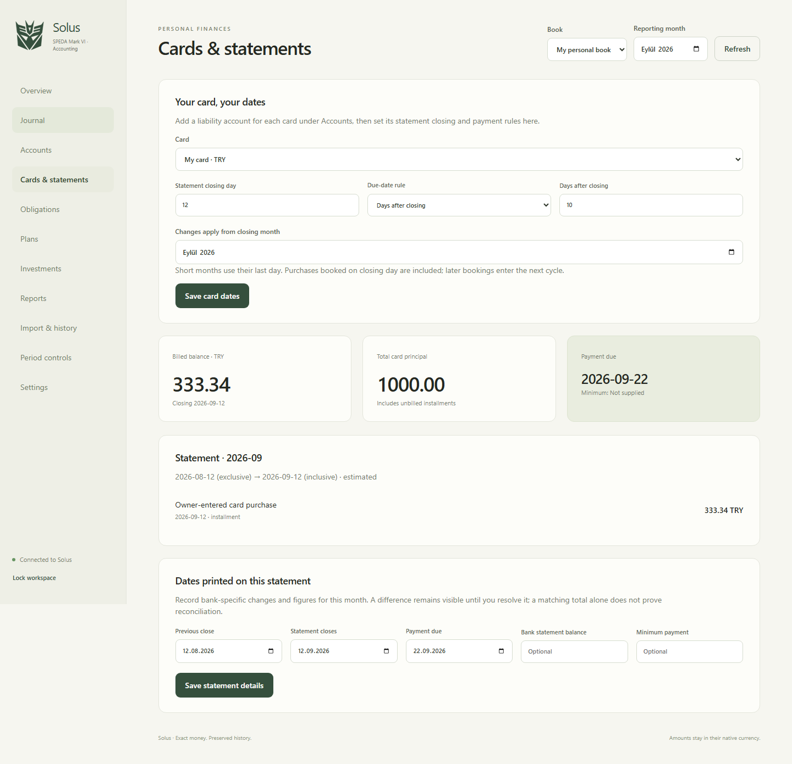
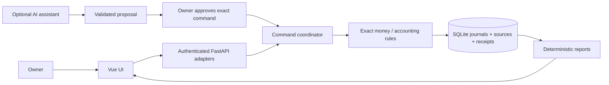

# Solus — SPEDA Mark VI Accounting Module

**AI-ready commands. Deterministic accounting. Your own books.**

**The accounting module of [SPEDA Mark VI](https://github.com/spedatox/speda-mark6), published here as a separately runnable module.**

Solus is a self-hosted accounting engine for personal finances and freelance or small-business bookkeeping. It pairs an exact double-entry ledger with a standalone Vue interface, configurable credit-card statement calendars and structured command contracts for AI assistants.

An assistant can propose a transaction. Python validates it, balances it, allocates every minor unit and commits an immutable receipt. Reports come from the ledger. The engine runs without an LLM, an API subscription or SPEDA.



## What it does

- Double-entry journals, assets, liabilities, equity, income and expense accounts; independent personal/business books.
- Integer money with currency-specific precision, balanced entries per currency and explicit FX entries. Native currencies remain separate.
- Printed statement-to-event reconciliation, separate billed/unbilled principal and source-specific billing dates.
- Credit-card purchases and installments; configurable closing/due rules, dated rule changes and overrides from individual statements. Bank booking dates determine statement inclusion.
- Loans, invoices, bills, partial settlements, refunds and reversals with preserved history.
- Budgets, recurring estimates, goals and projections, separated from actual postings.
- Investment cost lots, explicit disposals, realized gains/losses and dated valuation observations.
- Mapped CSV imports with preview, source retention and atomic commit; signed statement reconciliation and stale-review detection.
- Period closing, immutable journals enforced by SQLite triggers, idempotent commands and recovery of uncertain browser saves.
- Password setup/login, revocable sessions, CSRF checks, login throttling and Settings to change the password.

## Run locally

Requirements: Python 3.11+ and Node 22.12+ (Node 24 is tested).

```sh
git clone https://github.com/spedatox/solus.git
cd solus
python -m venv .venv
# Linux/macOS:
source .venv/bin/activate
# Windows PowerShell instead: .\.venv\Scripts\Activate.ps1
python -m pip install -e ".[test]"
cd ui
npm ci
npm run build
cd ..
python -m solus setup-link
python -m solus serve
```

Open the private setup URL printed by `setup-link` within 15 minutes, choose your password, then create a book and its accounts. There are **no default credentials**. `setup-link` and the server must use the same data-directory/database configuration. Subsequent visits use `http://127.0.0.1:8000/solus`.

Set `SOLUS_DATA_DIR` to choose the data folder. `SOLUS_DATABASE_URL` optionally selects a SQLite file. `SOLUS_API_KEY` optionally enables trusted service access through `X-API-Key`; generate your own random key and keep it server-side. Environment variables must be exported; `.env` is an example, not automatically loaded.

A synthetic, disposable library example:

```sh
python examples/card_purchase.py
```

## Docker

```sh
docker build -t solus:local .
docker volume create solus-data
docker run --rm -v solus-data:/data solus:local solus setup-link
docker run --rm -p 127.0.0.1:8000:8000 -v solus-data:/data solus:local
```

Use the printed setup URL after the server starts. A newly created Docker volume is owned by the image's unprivileged user; existing bind mounts require appropriate ownership. For remote access, place it behind HTTPS and pass `--trusted-proxy` with the **actual reverse proxy address**, never `*`. See [deployment and security](docs/SECURITY.md).

## The accounting/AI boundary



`solus.ai.command_tool()` exposes a provider-neutral JSON Schema. `propose()` validates a model's structured output without writing. A trusted host obtains owner approval of the exact proposal; `approve_proposal()` verifies its fingerprint before committing. Approval must never be delegated back to the model. There is no built-in chat model or claim that model output is deterministic.

See [SPEDA module integration](docs/SPEDA_INTEGRATION.md), [AI integration](docs/AI_INTEGRATION.md), [architecture](docs/ARCHITECTURE.md) and [accounting walkthrough](docs/ACCOUNTING_101.md).

## Verify

```sh
# Build UI first; HTTP tests inspect the compiled assets.
PYTHONDONTWRITEBYTECODE=1 python -m pytest -p no:cacheprovider
cd ui
npm test
```

PowerShell: `$env:PYTHONDONTWRITEBYTECODE='1'; python -m pytest -p no:cacheprovider`. Test databases use the OS temporary directory. CI runs accounting/security tests, UI retry tests and a real browser flow on synthetic data. [Test details](docs/TESTING.md).

## Scope and provenance

This is an initial standalone release. It targets a single owner and SQLite. It does not implement payroll, statutory tax filings, bank feeds, multi-user permissions or consolidated conversion of different currencies. Reports are bookkeeping outputs, not a certified statutory accounting package. Database contents are not encrypted by Solus; secure the host and backups.

Solus was designed by **Ahmet Erol Bayrak** and developed with AI-assisted engineering inside [SPEDA Mark VI](https://github.com/spedatox/speda-mark6). This repository is a separately runnable portfolio edition of the module; the integrated SPEDA implementation remains in its original repository. The standalone host replaces Igor-specific memory admission/projections with explicit owner approval and an atomic extension point. No production databases, owner transactions, credentials or SPEDA memory corpus are included.

Licensed under [AGPL-3.0-or-later](LICENSE), matching the original project. See [provenance](NOTICE.md).
